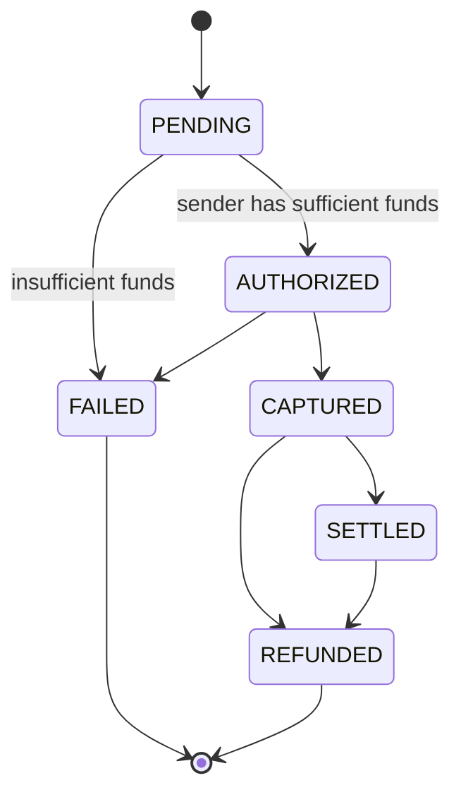

# Idempotent Payment Processing API

[](https://github.com/sanjivu1207/TrueState/actions/workflows/ci.yml)


A backend service that simulates how real payment processors (Visa, Stripe,
etc.) safely move money — guaranteeing a transaction happens **exactly
once**, even when clients retry, networks fail mid-call, or duplicate
requests arrive concurrently. This is the core hard problem in payments
engineering, and the focus of this project.

## The problem, in one sentence

Networks are "at-least-once": a client that doesn't get a response has no
way to know if the server never received the request, or received it and
died before replying — so it retries, and a naive API charges the customer
twice. This project makes retrying always safe.

## Highlights

- **Idempotency-key deduplication** — a retried request with the same key
  replays the original response byte-for-byte instead of reprocessing;
  reusing a key with a *different* payload is rejected outright
- **Deadlock-safe row locking** — concurrent transfers touching the same
  accounts always lock rows in a consistent order, so they queue up instead
  of deadlocking
- **An explicit transaction state machine** — every status change (`PENDING
  → AUTHORIZED → CAPTURED → SETTLED`, with `FAILED`/`REFUNDED` branches)
  is checked against an allow-list; illegal jumps are rejected with `409`
- **No double-charging, proven, not just asserted** — a committed test
  suite fires real concurrent load (50 duplicate requests, a 20-way
  overdraft race) against real Postgres and checks the database directly
- **Integer cents everywhere** — money is never represented as a float

## Architecture at a glance



**How a `POST /payments` request is handled:**

1. Look up the `Idempotency-Key` header in `idempotency_records`.
   - Key seen before, same request body, already finished → return the
     stored response. Don't touch the database again.
   - Key seen before, *different* request body → `422`. The client is
     misusing the key.
   - Key seen before, still being processed by a concurrent request → wait
     briefly for it to finish and replay its result, rather than racing it.
   - New key → claim it (a short, immediately-committed transaction) and
     continue.
2. Lock both the sender's and receiver's account rows with
   `SELECT ... FOR UPDATE`, always in ascending account-ID order — so two
   transfers between the same pair of accounts, even in opposite
   directions, can never deadlock waiting on each other.
3. Move the balance, write the transaction row, and mark the idempotency
   key completed — all in **one** database transaction. That last part is
   what makes "the server wrote the change but crashed before responding"
   safe to retry: the client retries with the same key, finds it already
   completed, and gets the original response instead of a double-charge.

## Tech stack

| Layer | Choice |
|---|---|
| API | FastAPI (Python 3.12) |
| Database | PostgreSQL 16 — real row-level locking, real ACID transactions |
| ORM | SQLAlchemy 2.0 |
| Tests | pytest, run against real Postgres (see [why](#a-real-bug-this-project-caught) below) |
| Containerization | Docker + Docker Compose |

## Quickstart

```bash
git clone <this-repo> && cd TrueState
docker compose up --build
```

- API: http://localhost:8000
- Interactive docs (Swagger UI): http://localhost:8000/docs
- Health check: `GET /health`

Try the core guarantee yourself — send the same payment twice with the same
`Idempotency-Key`:

```bash
ALICE=$(curl -s localhost:8000/accounts -H 'Content-Type: application/json' \
  -d '{"owner_name":"Alice","starting_balance_cents":10000}' | python3 -c 'import sys,json;print(json.load(sys.stdin)["id"])')
BOB=$(curl -s localhost:8000/accounts -H 'Content-Type: application/json' \
  -d '{"owner_name":"Bob","starting_balance_cents":0}' | python3 -c 'import sys,json;print(json.load(sys.stdin)["id"])')

KEY=$(python3 -c 'import uuid;print(uuid.uuid4())')
BODY="{\"from_account_id\":\"$ALICE\",\"to_account_id\":\"$BOB\",\"amount_cents\":2500}"

curl -s localhost:8000/payments -H "Idempotency-Key: $KEY" -H 'Content-Type: application/json' -d "$BODY"
echo
curl -s localhost:8000/payments -H "Idempotency-Key: $KEY" -H 'Content-Type: application/json' -d "$BODY"
# ^ identical response both times — Bob is credited once, not twice
```

## API reference

| Method | Path | Description |
|---|---|---|
| `GET` | `/health` | Liveness + DB connectivity |
| `POST` | `/accounts` | Create an account |
| `GET` | `/accounts/{id}/balance` | Check balance |
| `POST` | `/payments` | Initiate a payment (**requires** `Idempotency-Key` header) |
| `GET` | `/payments/{id}` | Check a payment's status |
| `POST` | `/payments/{id}/capture` | `AUTHORIZED → CAPTURED` |
| `POST` | `/payments/{id}/refund` | `CAPTURED`/`SETTLED → REFUNDED` (reverses the transfer) |

## Testing

```bash
docker compose up -d db      # just the database
python3 -m venv .venv && source .venv/bin/activate
pip install -r requirements.txt
pytest -v
```

**15/15 tests pass**, covering the idempotency contract, every legal and
illegal state transition, and — the two that matter most — concurrent load:

- `test_50_concurrent_identical_requests_create_exactly_one_transaction` —
  fires 50 threads at `POST /payments` with the same `Idempotency-Key` and
  asserts the database has **exactly one** transaction row, and all 50 HTTP
  responses are byte-identical.
- `test_concurrent_overdraft_race_never_takes_balance_negative` — fires 20
  threads with distinct debits against an account that can only cover 10 of
  them, and asserts the balance lands at exactly 0, never negative.

### A real bug this project caught

Tests here run against **real Postgres only, never SQLite** — and that
wasn't a stylistic choice. Early in development, the overdraft test above
ran against SQLite (no Docker available yet) and *passed status-code
checks* while quietly failing the thing that mattered: SQLite silently
ignores `SELECT ... FOR UPDATE`, so 19 of 20 concurrent requests reported
`201 Created` while only 2 debits actually landed — a textbook lost-update
race, invisible unless you check the database, not just the HTTP status
codes. The identical test against real Postgres serialized correctly:
exactly 10 succeeded, balance landed at 0. The fix was zero lines of
application code — it was running the test against the real database.

## Design decisions (interview-ready)

**Why integer cents instead of floats?** Floating-point can't represent
most decimal fractions exactly (`0.1 + 0.2 != 0.3` in IEEE 754), which is
unacceptable when the number represents money. `amount_cents` is always an
integer.

**Why lock account rows in a fixed order?** Deadlock prevention. If
transfer A locks account 1 then waits for account 2, while transfer B locks
account 2 then waits for account 1, both wait forever. Locking in ascending
account-ID order means every transaction requests locks in the same
sequence, so this cycle can't form.

**What happens if the same idempotency key is reused with a different
payload?** It's rejected with `422`. Silently processing it would let a
client "reuse" a key to smuggle a different transaction through — the
whole point of the key is that it identifies one specific request.

**At-least-once delivery vs. exactly-once effects.** Networks can't
guarantee exactly-once delivery — a client that times out genuinely cannot
tell whether the server never got the request or got it and crashed before
replying, so the only safe move is to retry. Idempotency keys don't change
that; they make retries harmless by turning "the server might process this
twice" into "the server recognizes this as the same request and returns
the original result." At-least-once delivery, exactly-once effect.

## Project status

| Phase | Status |
|---|---|
| 1. Schema, Docker Compose, health check | ✅ |
| 2. Idempotency-key handling + row-level locking | ✅ |
| 3. Transaction state machine + capture/refund | ✅ |
| 4. Concurrency test suite (committed, run against real Postgres) | ✅ |
| 5. `/simulate-failure` — inject a crash after commit, before response, to test client retry logic | Not started (stretch) |

## Project structure

```
app/
  main.py           FastAPI routes
  models.py         SQLAlchemy models (accounts, transactions, idempotency_records)
  schemas.py        Pydantic request/response models
  idempotency.py    Idempotency-key reservation, replay, and conflict handling
  payments.py       The locked balance transfer, capture, and refund logic
  state_machine.py  Allowed transaction-status transitions
  database.py       Engine/session setup
  config.py         Environment-based settings
tests/
  test_payments.py       Idempotency contract
  test_state_machine.py  State transitions, capture/refund
  test_concurrency.py    The two tests that prove the core claim
docker-compose.yml  API + Postgres
```
